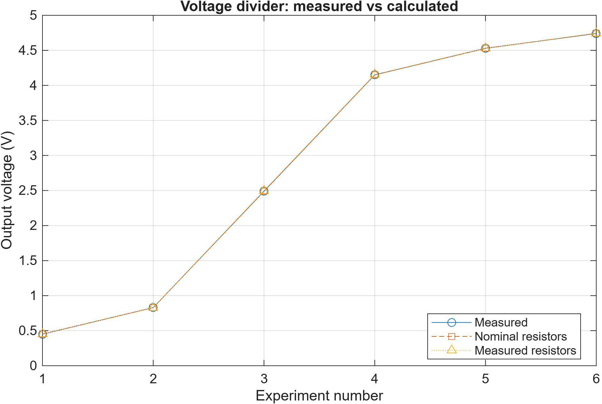
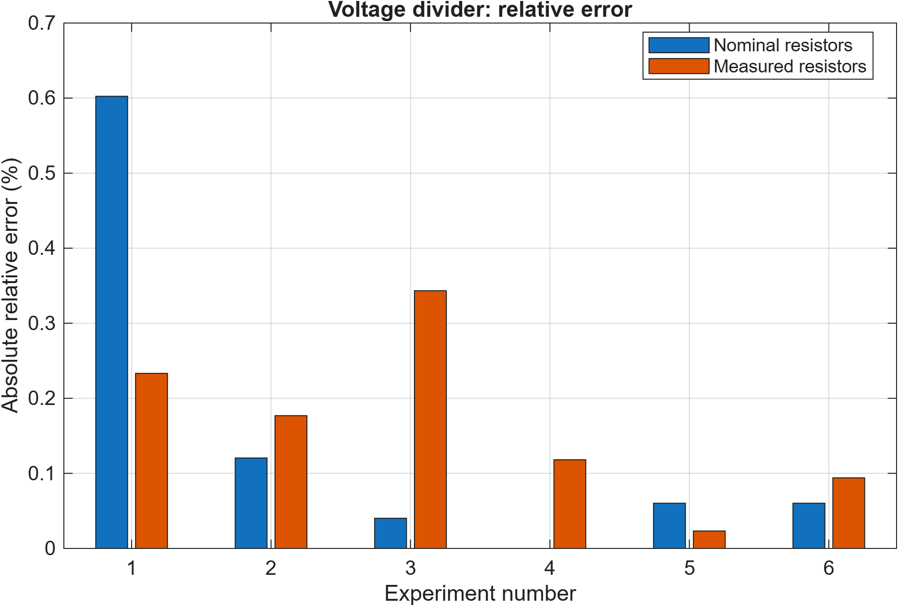

# DC Voltage Divider

**Igor Subbotin**

This is a learning project. I built six resistor circuits, measured the voltages, and compared them with MATLAB calculations. The input voltage was 4.98 V.

## Parts

Breadboard, jumper wires, DFRobot DFR0140 power module, 9 V adapter, Klein MM420 multimeter, two 1k resistors and two 10k resistors.

## Files

- [Report](voltage_divider_report.pdf): what I built and what I learned
- [MATLAB code](voltage_divider_analysis.m): calculations and graphs
- [Results](voltage_divider_results.csv): six tests
- [Meter check](voltage_divider_accuracy.csv): voltage ranges based on the meter limits
- [Photos](photos/): three output readings

## Run

1. Download `voltage_divider_analysis.m`.
2. Open the file in MATLAB.
3. Click **Run**.
   
The code saves two CSV files and two graphs in the current MATLAB folder.

## Results

The measured and calculated voltages were close. Test 4 has **0.00 %** difference using the resistor label values. Its blue bar has zero height. This does not mean the meter is perfectly accurate.

Current was calculated, not measured.

## Notes

- Current was calculated, not measured.
- The report explains the multimeter accuracy.

## Graphs

